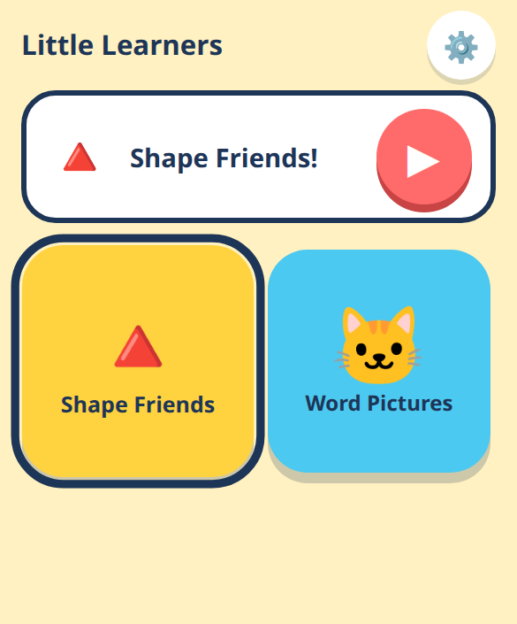
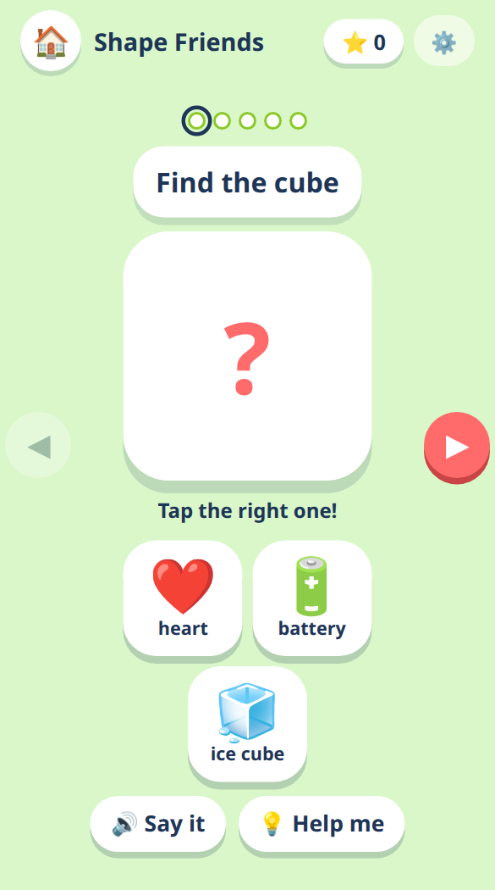
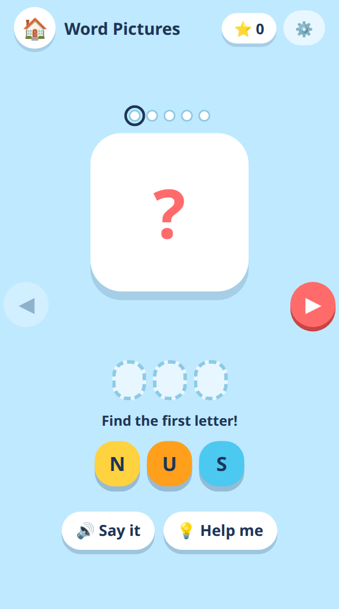

# Little Learners

Voice-narrated early-learning games for young children (about ages 3 to 6). Every game talks, so a child who
can't read yet can still play on their own. Big pictures, big buttons, short happy words, and nothing to sign up for.

**Play it:** https://tummala-hareesh.github.io/little-learners/

<p align="center">
  
  
  
</p>

## Contents

- [The games](#the-games)
- [Our promises](#our-promises)
- [Using it](#using-it)
- [How it's built](#how-its-built)
- [Development](#development)
- [Adding content](#adding-content)
- [Adding a new game](#adding-a-new-game)
- [Contributing](#contributing)
- [Licence](#licence)

## The games

### Playroom (the home screen)
Each game is a big picture tile. **Tap a tile once** and it says the game's name ("Shape Friends! Find the shapes!").
**Tap it again**, or press the big ▶, to start. A quick double-tap only picks the tile, so the name is always
heard first. Every game has a 🏠 button that comes back here.

### 🔺 Shape Friends (ages 3–5)
Two kinds of question, mixed in each round:
- **"Find the triangle"**: tap the real-world object with that shape (a pizza slice, a kite, a dice…).
- **"What shape is this?"**: an object is shown, tap its shape name.

It covers 8 flat shapes (circle, square, triangle, rectangle, star, oval, heart, diamond) and 6 solid shapes
(sphere, cube, cone, cylinder, pyramid, cuboid), using 21 everyday objects. Settings: 2D, 3D or both, 2–4
choices, and 3, 5 or 10 questions per round.

### 🐱 Word Pictures (ages 4–6)
A hidden picture and scrambled letter tiles. The child spells the word letter by letter. When it's done, the
picture appears and the word is **sounded out by phonics groups** (c‑a‑t, sh‑i‑p), each group lighting up as
it's spoken, then said whole.

There are 52 words from 2 to 6 letters (ox, cat, fish, apple, rabbit…). Settings: which word lengths to use
(pick several), and 3, 5 or 10 words per round. On a computer, children can also type the letters.

### 🐞 Number Pals (ages 3–6)
Counting with a voice that counts along. Two kinds of question, mixed in each round:
- **"How many bugs?"**: tap each thing to count it (each tap says the next number and shows it), then tap the
  right numeral. A wrong numeral just says "Let's count again!" and counts from one together.
- **"Show me 4 bugs"**: tap things into the 🧺 basket (counted aloud), tap one in the basket to take it out,
  then press ✅.

Settings: How many?, Show me or both, numbers 1–5 or 1–10, and 3, 5 or 10 questions per round. On a computer,
the digit keys answer "How many?" (0 is ten). Its girl/boy clips are made with the Kokoro voice generator
(see below). A "Number words" mode (spell ONE to TEN) is planned.

### 🚦 Sign Spotters (ages 3–6)
Road signs are shapes that mean something. Two kinds of question, mixed in each round:
- **"Find the stop sign!"**: tap the right sign out of three. The game says its name, its shape and what it
  means ("Stop sign. It's an octagon. Stop!").
- **Road trip**: a car drives up to a traffic light or a sign and waits. Tap 🛑 Stop, 🐢 Slow down or ✅ Go and
  the car obeys. At a walk sign the car stops and Teddy crosses with a grown-up.

Eight signs that look much the same in most countries: stop, traffic light, walk, crossing, school, road works,
give way and no entry. Every line about crossing says "with a grown-up" and "look and listen". Settings: Find the
sign, Road trip or both, and 3, 5 or 10 questions per round. On a computer, 1–3 pick an answer and S/G mean stop/go.
Its girl/boy voices are clips generated with Kokoro, like every other game.

### In every game
- 🔊 **Say it** repeats the question, and 💡 **Help me** highlights the right answer.
- A hint also appears by itself after 10 seconds without progress.
- Wrong answers just wobble with a gentle "Try again!" or "Look again!", and no stars are ever taken away.
- Stars count what was solved, and confetti and a fanfare celebrate each one.
- Swipe left or right, or use ◀ ▶, to move between questions (Shape Friends also takes the arrow keys).

## Our promises

These apps are made for small children, so:

- **No accounts, no ads, no tracking, no analytics.** Nothing a child does leaves the device.
- **Works offline.** Download it and open `index.html`; no internet needed (the rounded font is a nice-to-have).
- **No reading required.** Everything important is a picture or a sound.
- **Accessible:** big touch targets, keyboard support, screen-reader labels, readable contrast, and no motion
  for devices set to reduce motion.
- **Kind wording:** short, positive, and never punishing.

## Using it

**Online:** open https://tummala-hareesh.github.io/little-learners/ on a phone, tablet or computer.

**Offline:** download the repository (Code → Download ZIP), unzip it, and open `index.html` in a browser.

**Voices:** every game has a built-in girl voice and boy voice, recorded clips that work everywhere. In each
game's ⚙ settings you can also pick any English voice your device has.

**Grown-ups corner (home screen):** press and hold ⚙ for 2 seconds (or hold Enter/Space on it). A single tap
won't open it, so little fingers can't wander in. Inside you'll find the voice for the home screen and each
game's ages and what it teaches.

## How it's built

- **One HTML file per game, no build step, no dependencies.** HTML, CSS and JavaScript all live in the file.
- **Recorded audio in two voices.** Every spoken clip exists as `audio/<name>.wav` (girl) and
  `audio-m/<name>.wav` (boy), and the tests fail if either is missing.
- **Device voices as a fallback.** If a clip is missing or a device voice is chosen, the text is spoken with the
  browser's speech engine.
- **Relative links only**, so the same files work from disk, from a local server, and under `/little-learners/` on
  GitHub Pages.

```
index.html               Playroom home screen (the APPS table lists every game)
apps/
  shape-friends/         index.html + audio/ + audio-m/
  word-pictures/         index.html + audio/ + audio-m/
  number-pals/           index.html + audio/ + audio-m/
  sign-spotters/         index.html + audio/ + audio-m/
hub/                     home-screen name clips (audio/, audio-m/)
tests/                   Playwright tests: hub/, shape-friends/, word-pictures/, site/
tools/build-site.sh      assembles exactly what gets published
tools/voices/            Kokoro clip generator (build time only, never published)
.github/workflows/       CI: tests on every PR; deploy to GitHub Pages from main
docs/images/             screenshots for this README
```

## Development

You need Node 20+ and Python 3 (for the small local web server).

```bash
npm install              # once: Playwright test runner
npx playwright install chromium
npm run serve            # http://127.0.0.1:4173/
npm test                 # all tests, desktop + phone (Pixel 7) profiles
npx playwright test tests/word-pictures      # one area
```

The tests play real rounds in a browser: right and wrong answers, hints, keyboard, swipes, settings, the
grown-ups gate, 🏠 round trips, and opening from `file://`. They also check the content: every word's phonics
add up, every shape has objects, every referenced clip exists in both voices, and every game folder is listed on
the home screen. Randomness is seeded, audio is silenced, time is simulated and the network is blocked, so
runs are repeatable.

**CI and deploy:** GitHub Actions runs the tests on every pull request and on `main`. When they pass on `main`, the
`deploy` job builds the site with `tools/build-site.sh` and publishes it to GitHub Pages. Only git-tracked files
from `index.html`, `apps/` and `hub/` are published (no tests, tooling or symlinks). Pull requests never deploy.

## Adding content

Content lives in small tables at the top of each game's script, so you never need to touch the game logic.

**Shape Friends:** `SHAPES_2D` / `SHAPES_3D` list the shapes, and `OBJECTS` lists the real-world objects
(`{ k, say, e, shape }`). Every shape needs at least one object. New clips: `shape-<shape>.wav`, `obj-<k>.wav`.

**Word Pictures:** `WORDS` lists the words and emoji (`{ w, e }`, 2–6 uppercase letters), and `PHONICS[word]`
splits each word into sound groups (`[sound, letterCount]`), whose letter counts must add up to the word length.
New clips: `w-<word>.wav`, plus `ipa-<sound>.wav` for any new sound.

Every new clip needs **both** voices (same filename in `audio/` and `audio-m/`); `npm test` tells you exactly
what's missing. All games and the home screen generate their clips: `tools/voices/` turns each app's own clip list
and text into both voices with [Kokoro](https://huggingface.co/hexgrad/Kokoro-82M), offline (see
`tools/voices/README.md`). Word Pictures' phonics sounds (`ipa-*`) are the exception: they are hand-recorded, so
regenerate that app with `--skip ipa-`.

## Adding a new game

1. Create `apps/<id>/index.html` (copying an existing game is the quickest start), with `audio/` and `audio-m/`.
2. Keep the shared 🏠 button in its header: `<a class="home" href="../../index.html" aria-label="Home">🏠</a>`.
3. Add one entry to `APPS` in the root `index.html`:
   ```js
   { id: "<id>", href: "apps/<id>/index.html", e: "🦉", name: "Owl Counting",
     say: "Owl Counting! Count with me!", ages: "3–5", skills: "Counting to 10" }
   ```
   Use a picture emoji, never letters.
4. Make the name clip in both voices (`hub/audio/app-<id>.wav`, `hub/audio-m/app-<id>.wav`):
   `node tools/voices/manifest.js hub && tools/voices/.venv/bin/python tools/voices/make_clips.py hub`.
   Until then, add `clips: false` to the entry and the home screen speaks the name with the device voice.
5. Add tests under `tests/<id>/`, following the existing games, and run `npm test`. The home-screen tests fail if
   a game folder isn't listed, or a listed game is missing.

## Contributing

Ideas, bug reports and pull requests are welcome. Please keep to the promises above (no tracking or data
collection, works offline, no reading required) and run `npm test` before opening a PR.

## Licence

No licence has been chosen yet, so all rights are reserved by default. If you'd like to reuse this work, please
open an issue to ask.
